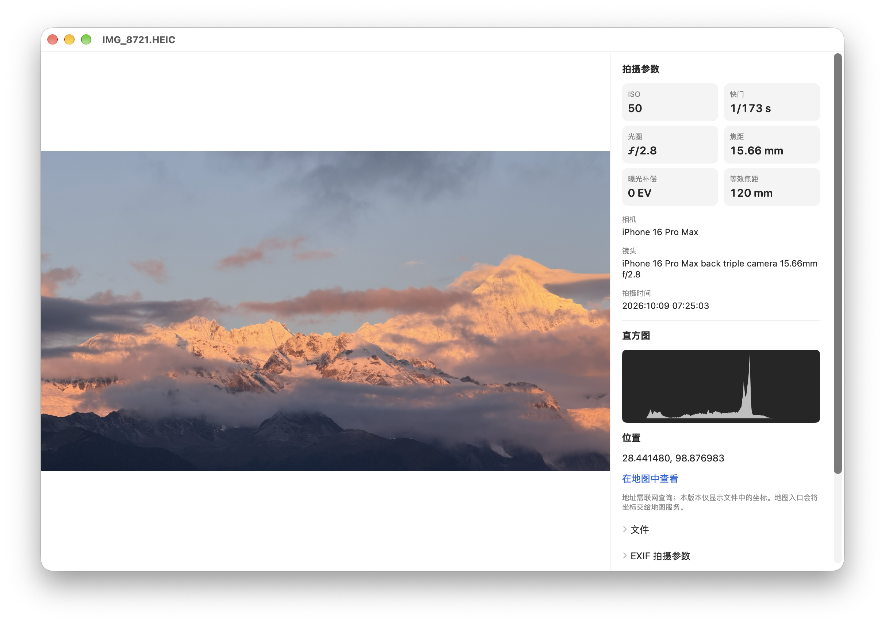
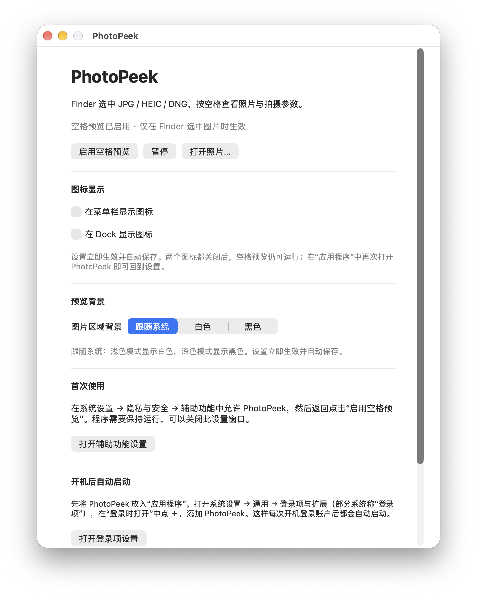

# QLPhoto — macOS 照片空格预览与拍摄信息工具

[English](README.en.md) · 简体中文

macOS 照片预览工具。在 Finder 中选中照片，按空格查看图片、拍摄参数和直方图。

基于 Swift、AppKit、SwiftUI 和系统 Image I/O，不依赖第三方运行时。最低部署目标为 macOS 13。

## 截图

以下为**示意占位图**，仅用于展示布局；对外发布前请替换为真实截图（保持文件名不变即可）。

### 空格预览窗口



### 设置与图标开关



## 功能

- JPG / JPEG、HEIC / HEIF、DNG 预览；DNG 解码兼容性取决于 macOS 与相机型号。
- ISO、快门、光圈、焦距、曝光补偿、等效焦距，以及相机、镜头、拍摄时间和原始元数据。
- 曝光直方图、GPS 坐标及 Apple 地图入口。
- 滚轮缩放、按住左键拖动、双击恢复适应窗口。
- ↑ / ↓ 按 Finder 暴露的列表顺序切换并同步选中项；不支持的项目显示提示后仍可继续切换。
- HEIC / HEIF 按静态照片预览；实况照片功能暂时停用。
- 拍摄参数独立读取、读到即显示；骨架布局、小图优先加载，加载完成直接替换，无淡入动画；过期结果不会覆盖当前照片。
- 按屏幕记忆窗口位置和尺寸；首次打开在 Finder 所在屏幕可用区域居中。
- 菜单栏 / Dock 图标独立开关，图片背景可选跟随系统、白色或黑色。

## 安装与使用

1. 自行构建，或使用项目发布者提供的安装包，将 `QLPhoto.app` 放入“应用程序”。
2. 启动 QLPhoto，在“系统设置 → 隐私与安全 → 辅助功能”中允许它。
3. 返回应用，点击“启用空格预览”，在 Finder 中选中支持的照片并按空格。
4. 按 ↑ / ↓ 切换；空格、Esc 或 ⌘W 关闭。建议先使用 Finder 列表视图。

关闭首页窗口后程序继续运行。两个图标都隐藏时，在“应用程序”中再次打开 QLPhoto 可恢复首页。启用状态与显示设置会自动保存。

开机自动运行：在“系统设置 → 通用 → 登录项与扩展 → 登录时打开”中添加 QLPhoto；首页提供系统设置入口。程序在登录账户后启动，辅助功能权限需单独授予。

当前使用本地临时签名，更新后辅助功能权限可能失效。可在系统设置移除旧条目，再添加应用并重新启用。公开二进制分发建议使用 Developer ID 签名及 Apple 公证；仓库不包含签名证书。

旧名称版本升级到 QLPhoto 时，请先退出旧应用，再为 QLPhoto 重新授予辅助功能权限并启用空格预览。应用标识符已随更名调整，旧版偏好设置不会自动迁移；如设置了登录项，请更新为 QLPhoto。

## 使用 AI Agent 安装

可以让能执行本地命令的 AI Agent 阅读本仓库，按 [AGENTS.md](AGENTS.md) 和 [安装指南](docs/AGENT_INSTALL.md) 下载、编译并安装。复制下面的指令，并附上本仓库链接或本地路径：

> 请阅读这个仓库的 AGENTS.md 和 docs/AGENT_INSTALL.md，检查我的环境，帮我下载、编译并安装 QLPhoto。遇到需要我操作的系统授权时告诉我。

需要 macOS 和完整 Xcode。辅助功能权限仍需你在系统设置中手动授予。

## 构建

需要 macOS、完整 Xcode 及对应 macOS SDK。最低部署目标不代表已在所有 macOS / Xcode 版本上实测。命令行需选择完整 Xcode，并按系统提示完成首次运行设置。

```sh
# 在仓库根目录
bash scripts/build.sh
```

默认生成 `build/DerivedData/Build/Products/Release/QLPhoto.app`，使用本地临时签名。也可直接打开 `QLPhoto/QLPhoto.xcodeproj`，选择共享的 `QLPhoto` scheme。

已提交 Xcode 工程，普通构建无需安装 XcodeGen。修改 target、文件列表或类型声明时，同步 `QLPhoto/project.yml` 与生成的工程；安装 XcodeGen 后可执行：

```sh
cd QLPhoto
xcodegen generate
```

## 检查

```sh
# 不需要照片或辅助功能授权的逻辑检查
bash scripts/check.sh

# 用你自己的照片验证解码、元数据和 HTML 预览；文件不会上传
bash scripts/check.sh /absolute/path/photo.jpg /absolute/path/photo.dng /absolute/path/photo.heic

# 本地交互式桌面会短暂显示测试窗口；CI 不运行这组
bash scripts/check.sh --ui /absolute/path/photo.dng /absolute/path/photo.jpg
```

传入 `.heic` / `.heif` 会额外运行（已停用的）实况照片检查；`--ui` 同时传入 `.dng` 与 `.jpg` / `.jpeg` 会额外运行快速切图加载检查。CI 在 macOS 上构建未签名应用并运行基础检查。Finder 真实按键、辅助功能授权、多屏仍需人工验证，参见 [贡献指南](CONTRIBUTING.md)。

## 限制

- 当前主方案是辅助功能驱动的独立预览窗口。仓库保留实验性数据型 Quick Look 扩展，但不保证系统选择它接管 JPG / HEIC / DNG。扩展为静态 HTML，未包含主应用的全部交互功能。
- 预览最长边为 3200 像素，放大不是原始像素级 100% 查看；直方图基于降采样 sRGB 预览，按 Rec. 709 亮度单通道归一化。
- 不提供 RAW 调色、完整 HDR / 增益图显示，也不支持全部相机 RAW 格式。
- 实况照片功能暂时停用：不扫描或配对同目录视频，不显示播放按钮及实况状态。HEIC 静态预览不受影响。
- Finder 部分视图、虚拟列表或不可读项目可能无法切换；程序会提示，不自行按文件名重排。多选只打开第一个可识别图片。
- DNG 内嵌小图不存在时等待完整解码；系统正在进行的解码不能强制终止，过期结果会丢弃。

## 隐私

照片解码、元数据和直方图均在本机处理。没有分析统计、自动上传或更新服务。全局按键处理仅用于 Finder 空格预览，不记录键盘内容。点击地图链接会将照片坐标交给地图服务。侧栏会按原样列出文件内的原始元数据字段，可能包含 GPS、设备型号、序列号与拍摄时间等隐私信息，截图分享前请自行遮挡。请勿在公开 issue 中上传含私人 GPS / EXIF 的原图。详见 [安全与隐私说明](SECURITY.md)。

## 目录

| 路径 | 内容 |
| --- | --- |
| `QLPhoto/App/` | 应用生命周期、设置、Finder 按键及窗口管理 |
| `QLPhoto/Sources/` | 解码、元数据、直方图、图片交互与 HTML 预览 |
| `QLPhoto/Extension/` | 实验性 Quick Look 扩展 |
| `QLPhoto/Checks/` | 独立 Swift 检查入口 |
| `scripts/` | 构建、检查和打包脚本 |

欢迎提交问题与改进，参见 [CONTRIBUTING.md](CONTRIBUTING.md)。本项目采用 [MIT License](LICENSE)。
